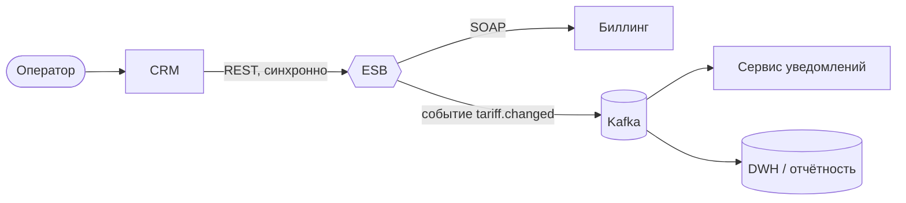

# Интеграция CRM и биллинга через ESB: смена тарифного плана

Учебный кейс системного аналитика. В нём описано, как система CRM, где работает оператор, меняет тарифный план абонента в биллинге через интеграционную шину (ESB): от бизнес-требований до API-контракта и критериев приёмки.

Автор: **Сагыныш Мешитбек**, системный аналитик · [Telegram](https://t.me/sagynyshsssm) · meshitbek.s@gmail.com

> Компании, системы и данные в кейсе вымышленные. Цель — показать подход к анализу и оформлению требований на интеграцию.

## Задача

Сейчас оператор контакт-центра меняет тариф абонента вручную в двух системах: сначала в CRM, потом в биллинге. Из-за этого бывают расхождения: в CRM тариф новый, а списания идут по старому. Нужно, чтобы смена тарифа делалась в одном месте (CRM), а биллинг получал изменения автоматически и централизованно, через ESB, а не прямой интеграцией «точка-точка».

## Что внутри

| Артефакт | Файл | Что показывает |
| --- | --- | --- |
| Бизнес-требования | [docs/01-business-requirements.md](docs/01-business-requirements.md) | Цель, участники, BR, Use Case в текстовом виде |
| Use Case диаграмма | [diagrams/use-case.md](diagrams/use-case.md) | Акторы и сценарии (Mermaid + PlantUML) |
| Sequence диаграмма | [diagrams/sequence.md](diagrams/sequence.md) | Синхронный вызов REST и асинхронное событие в брокер |
| Техническое задание | [docs/02-technical-specification.md](docs/02-technical-specification.md) | Интеграция, маппинг полей, ошибки, логирование, НФТ |
| API-контракт | [api/openapi.yaml](api/openapi.yaml) | OpenAPI 3.0: методы, схемы, коды ошибок, примеры |
| Модель данных | [db/schema.sql](db/schema.sql), [db/queries.sql](db/queries.sql) | Таблицы, ключи, индексы, SQL-запросы для проверки |
| Критерии приёмки | [docs/03-acceptance-criteria.md](docs/03-acceptance-criteria.md) | Gherkin-сценарии и чек-лист тестирования |

## Архитектура в двух словах

- **CRM → ESB** — REST/JSON, синхронно: оператору сразу нужен результат.
- **ESB → Биллинг** — SOAP/XML: в кейсе биллинг legacy и умеет только SOAP, ESB трансформирует запрос.
- **ESB → Kafka** — асинхронное событие `tariff.changed`: SMS абоненту и отчётность не должны тормозить ответ оператору.

## Как смотреть

- Диаграммы Mermaid отображаются прямо на GitHub.
- `api/openapi.yaml` можно открыть в [Swagger Editor](https://editor.swagger.io/): вставьте содержимое файла и посмотрите документацию.
- Исходники PlantUML лежат рядом с диаграммами, их можно открыть в [PlantUML Online](https://www.plantuml.com/plantuml).

## Навыки, которые показывает кейс

Анализ и формализация бизнес-требований · UML (Use Case, Sequence) · проектирование интеграций REST / SOAP / брокер сообщений · OpenAPI 3.0 (yaml) · ТЗ в markdown · модель данных и SQL · критерии приёмки и уровни тестирования
