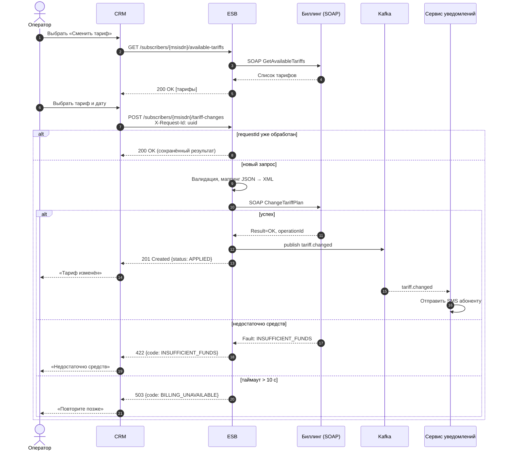
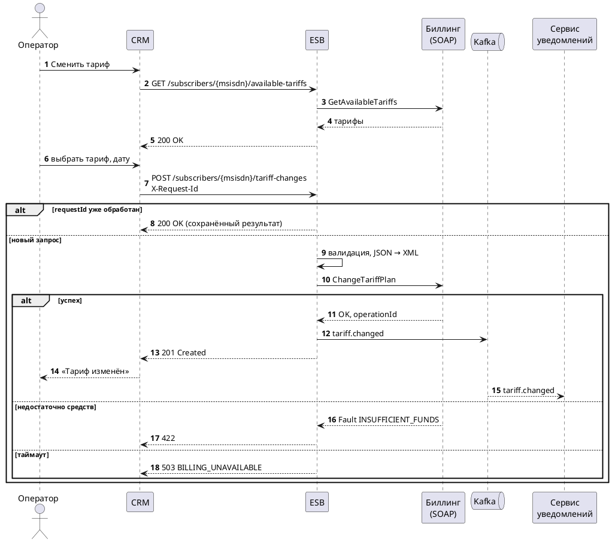

# Sequence диаграмма: смена тарифа

**Почему так:**

- **Синхронный ответ CRM** нужен, потому что оператор ждёт результат на экране.
- **SMS идёт асинхронно через Kafka**, чтобы медленная отправка SMS не задерживала ответ оператору и не могла откатить уже выполненную смену.
- **Заголовок `X-Request-Id`** обеспечивает идемпотентность: повтор после таймаута не создаёт второй смены тарифа.

## Исходник PlantUML

