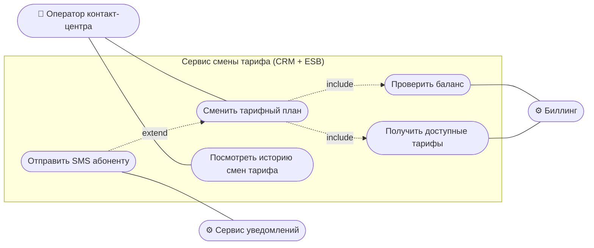
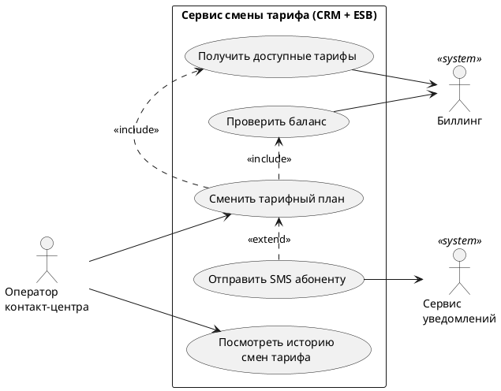

# Use Case диаграмма

**Как читать:** «Сменить тариф» всегда включает (`include`) получение доступных тарифов и проверку баланса. Отправка SMS расширяет (`extend`) основной сценарий: она выполняется после успешной смены, и её сбой не отменяет смену тарифа.

## Исходник PlantUML

